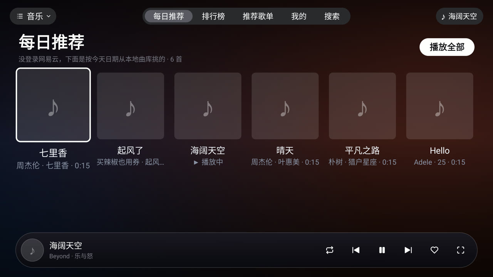
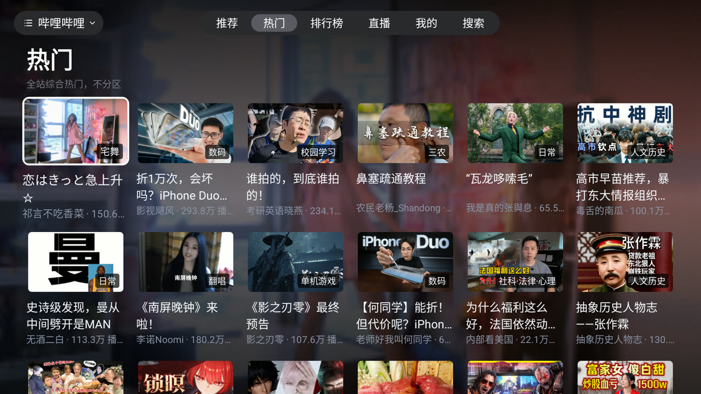
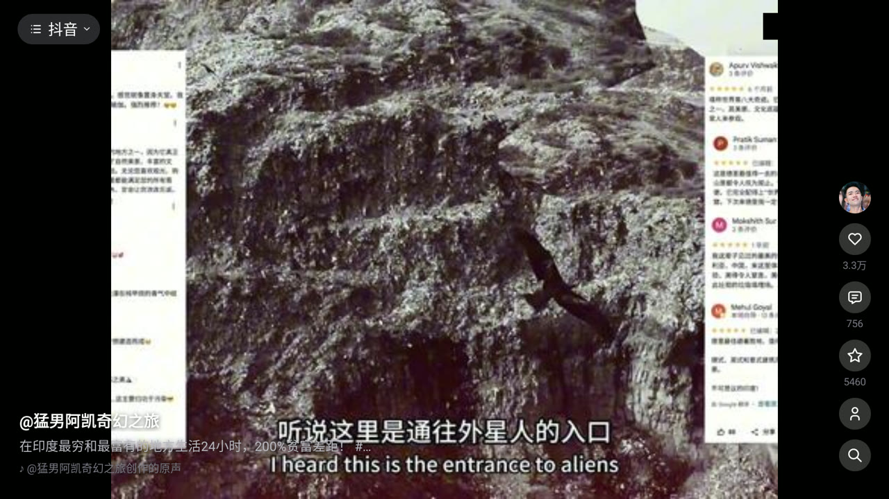
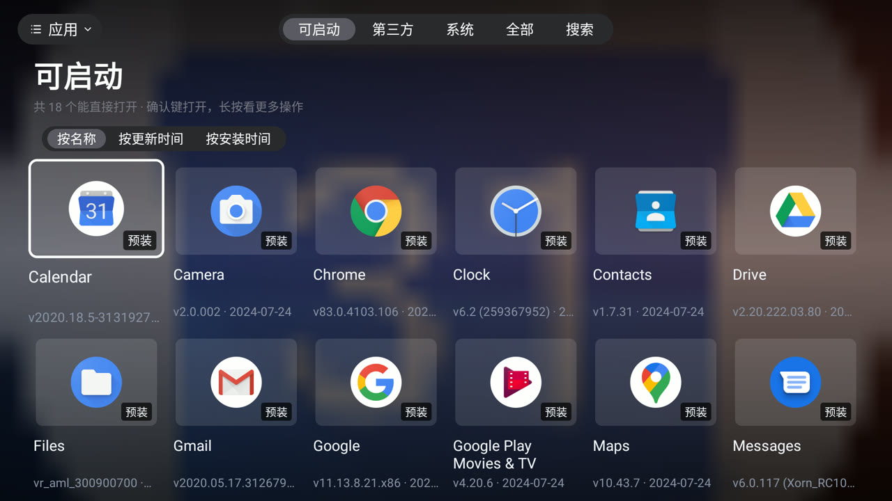

# TVDesk

Android TV 桌面壳应用。启动后是一台电视的主屏：海报墙形式的影视、在线音乐、哔哩哔哩、抖音、
本地已安装应用、信号源与设置，全部在同一个 Activity 内切换，不跳窗口、不抢焦点。

- 包名：`com.tvdesk.app`
- 入口：`com.tvdesk.desk.DeskActivity`（唯一 LAUNCHER / LEANBACK_LAUNCHER）
- 最低系统：Android 4.4（`minSdk 19`）· 目标：`targetSdk 28`
- 语言：Java，无 coreLibraryDesugaring（写代码前注意 API 级别，`String.join` 这类 API 26 的方法不可用）
- 许可：AGPL-3.0，见 [LICENSE](LICENSE)
- 发行包下载：[Releases](https://github.com/Zxxy326/TVDesk/releases/latest)（含选包、安装与校验说明）

## 版块

| 版块 | 说明 |
| --- | --- |
| 桌面 | 海报墙首页，影视直接由顶栏接管，进页面即出内容 |
| 音乐 | 五个栏目，在线音源走各平台 HTTP 接口，含扫码/Cookie 登录 |
| 抖音 | 竖屏一屏一条的信息流，ExoPlayer 播放，右键开评论抽屉；Cookie 经局域网表单导入 |
| 哔哩哔哩 | 卡片墙 + 详情页 + 播放器 + 扫码登录与「我的」 |
| 应用 | 本地已安装应用卡片墙，可启动 / 卸载 |
| 信号源 | 内容源地址配置与 HDMI / AV 输入源 |
| 设置 | 应用内设置页，`exported=false`，只由桌面内部跳入 |

## 界面预览

| | |
| --- | --- |
| <br>**桌面**：海报墙首页，顶栏接管影视分类，Hero 给简介与「开始播放 / 收藏 / 详情」 | <br>**音乐**：五个栏目，在线音源走各平台 HTTP 接口，底部是悬浮播放条 |
| <br>**音乐 · 沉浸播放页**：黑胶唱机配歌词列，空闲时只留盘和词 | <br>**哔哩哔哩**：卡片墙 + 详情页 + 播放器 + 扫码登录与「我的」 |
| <br>**抖音**：竖屏一屏一条的信息流，右侧操作栏，右键开评论抽屉 | <br>**应用**：本地已安装应用卡片墙，可启动 / 卸载 |

## 模块结构

```
app/     TVBox 能力层（解析、播放器、DLNA、采集接口）
core/    TVDesk 自己的接口层与工具（各平台客户端、签名器、Feed 适配）
desk/    桌面 UI（DeskActivity 与内嵌页面）
player/  播放器封装
quickjs/ QuickJS JNI 封装，供 core 里的 JS 算法运行
```

## 构建

需要 JDK 17 与 Android SDK。

```bash
./build.sh            # java32Debug（armeabi-v7a，电视用）
./build.sh java64     # arm64 调试包
./build.sh java       # 双 ABI
./build.sh install    # 编译并 adb install 到已连接设备
./build.sh release    # 发行三包：armeabi-v7a / arm64-v8a / 全机型，收进 dist/
```

## 第三方代码与许可

本应用基于 TVBox 的能力层，并包含若干第三方算法实现，许可与来源逐项记录在：

- `LICENSE` — 本项目，AGPL-3.0
- `LICENSE-douyin_sign.txt` + `core/src/main/assets/douyin/NOTICE.txt` — 抖音 `a_bogus` 算法，Apache-2.0
- `core/src/main/assets/` 各目录内的说明 — 其余随包资源
