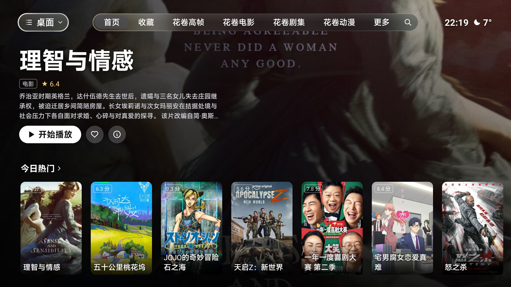
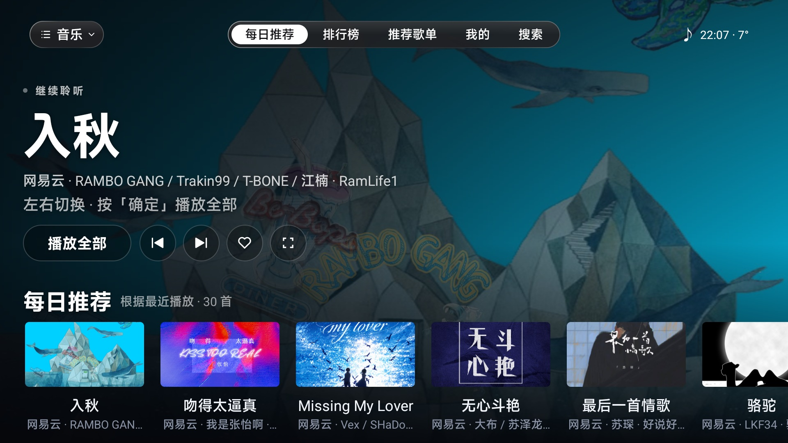
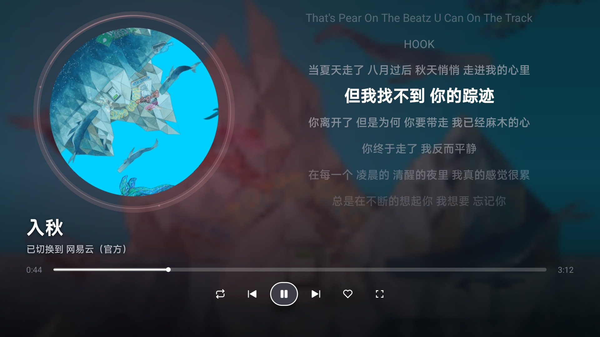
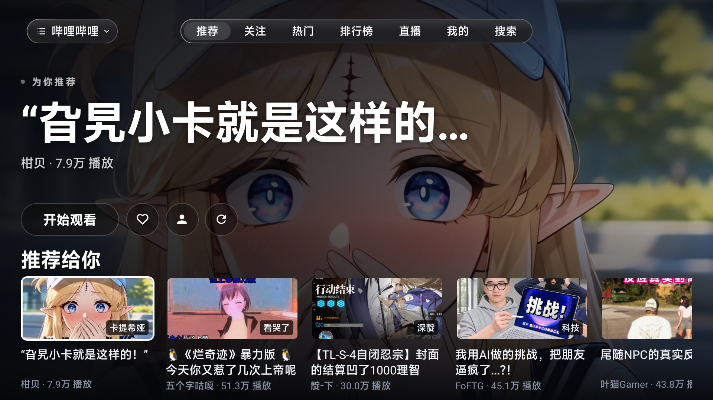
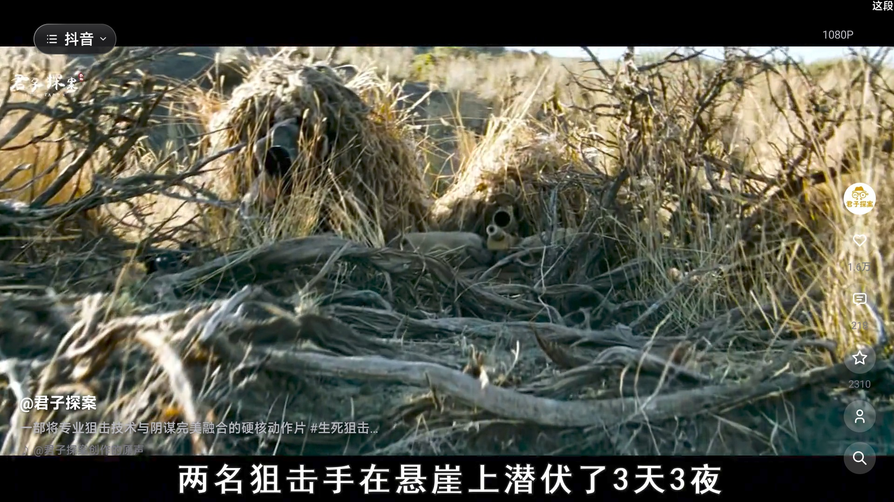
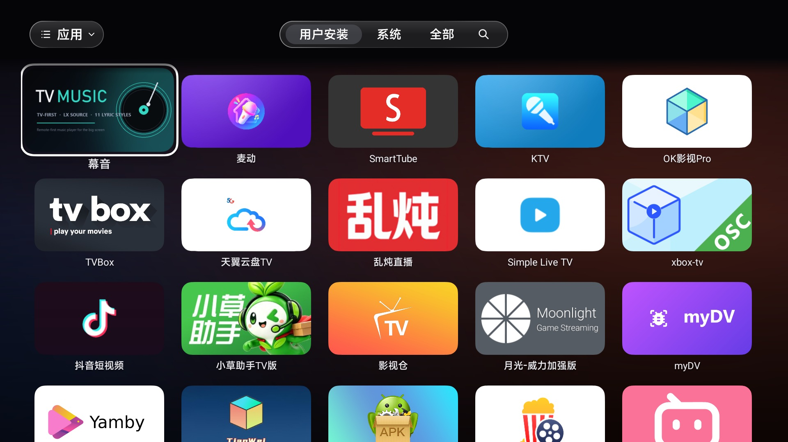

# TVDesk

Android TV 桌面壳应用。启动后就是一台电视的主屏：海报墙形式的影视、在线音乐、哔哩哔哩、抖音、
本地已安装应用、信号源与设置，全部在同一个 Activity 内切换，不跳窗口、不抢焦点。

- 当前版本：**1.2.5**（`versionCode 43`）
- 包名：`com.tvdesk.app`
- 入口：`com.tvdesk.desk.DeskActivity`（唯一 LAUNCHER / LEANBACK_LAUNCHER）
- 最低系统：Android 6.0（`minSdk 23`）· 目标：`targetSdk 28`
- 语言：Java，无 coreLibraryDesugaring（写代码前注意 API 级别，`String.join` 这类 API 26 的方法不可用）
- 许可：AGPL-3.0，见 [LICENSE](LICENSE)
- 发行包下载：[Releases](https://github.com/Zxxy326/TVDesk/releases/latest)

## 版块

| 版块 | 说明 |
| --- | --- |
| 桌面 | 海报墙首页，影视分类由顶栏接管，进页面即出内容；详情页记播放进度，下次接着上次那一集播 |
| 影视搜索 | 内嵌搜索页，**进入自动弹起系统输入法**（支持拼音与语音），不再有自绘字母键盘；最近搜索排在输入框下面一行 |
| 音乐 | 五个栏目（每日推荐 / 排行榜 / 推荐歌单 / 我的 / 搜索）。LX 音源脚本多源取流、链接缓存、手动选择音源、沉浸播放页三种风格、歌词与收藏 |
| 抖音 | 一屏一条的信息流，ExoPlayer 播放，弹幕 + 右侧操作栏，右键开评论抽屉；Cookie 经局域网表单导入 |
| 哔哩哔哩 | 卡片墙 + 详情页 + 播放器 + 扫码登录、「关注」动态与「我的」，滚动到底自动加载更多 |
| 应用 | 本地已安装应用磁贴墙，可启动 / 卸载，长按可移动并自定义排序 |
| 信号源 | 内容源地址配置与 HDMI / AV 输入源 |
| 设置 | 应用内设置页，`exported=false`，只由桌面内部跳入 |

### 音乐模块细节

- **多源取流**：内部统一走 `OnlineSourceResolver`，顺序为「持久化缓存 → 指定/首选音源 → JS 脚本 → 内置网易云官方接口 → 按元信息跨源搜索 → 代理兜底」；统一做音质降级、加密容器过滤、占位流过滤与同曲校验。
- **音源脚本**：支持 LX 规范的 `.js` 音源（QuickJS 运行），音源页可测试平台与音质、扫码导入、在线下载音源市场。
- **手动换源**：胶囊菜单「选择音源」列出内置源与已装脚本，选中后重新解析当前歌曲并保留队列与进度；「重新解析音源」会清掉这首歌的链接缓存再取。
- **链接缓存**：按 `songKey|source|quality` 缓存 15 分钟，进程重启仍有效；本机代理地址不缓存。
- **沉浸播放页**：三种风格 —— 动感涟漪、简约（圆形封面 + 外圈呼吸光弧 + 歌词列）、精简时钟。
- **登录**：网易云支持手机号 + 密码（EAPI）与扫码/粘 Cookie 两条路。

## 界面预览

| | |
| --- | --- |
| <br>**桌面**：海报墙首页，顶栏接管影视分类，Hero 给简介与「开始播放 / 收藏 / 详情」 | <br>**音乐**：五个栏目，底部悬浮播放条，在线音源走多源解析 |
| <br>**音乐 · 沉浸播放页**：圆形专辑封面外圈带呼吸光弧，右侧歌词列，空闲时只留盘和词 | <br>**哔哩哔哩**：卡片墙 + 详情页 + 播放器 + 扫码登录与「我的」 |
| <br>**抖音**：一屏一条的信息流，右侧操作栏与弹幕，右键开评论抽屉 | <br>**应用**：本地已安装应用卡片墙，可启动 / 卸载 |

## 最近更新

**1.2.5**

- 影视搜索页去掉自绘字母键盘，进入即弹系统输入法（可语音）；最近搜索改为输入框下方一行，结果墙占满整屏；返回键先收输入法、再退出。
- 音乐沉浸播放页改版：去掉黑胶唱机，改为圆形专辑封面 + 外圈动效光弧（旋转渐变弧 + 呼吸光晕）。

**1.2.3 / 1.2.4**

- 音乐对齐像素播放器 v1.7.2 / v1.8.0：新增「选择音源」「重新解析音源」、封面 JS 补全、跨源同曲匹配（±5s 时长闸 + 三级打分）、平台品牌色、网易云 EAPI 手机号登录。
- 恢复桌面内嵌音乐页，弃用 Compose 版（源码仍在 `musicui/`，不参与构建）。

## 模块结构

```
app/     TVBox 能力层（解析、播放器、DLNA、采集接口）
core/    TVDesk 自己的接口层与工具（各平台客户端、签名器、Feed 适配、音乐解析）
desk/    桌面 UI（DeskActivity 与内嵌页面、音乐页、搜索页）
player/  播放器封装
quickjs/ QuickJS JNI 封装，供 core 里的 JS 算法与音源脚本运行
musicui/ （已停用）Compose 版音乐模块，保留源码但不参与构建
```

## 构建

需要 JDK 17 与 Android SDK。

```bash
./build.sh            # java32Debug（armeabi-v7a，电视用）
./build.sh java64     # arm64 调试包
./build.sh java       # 双 ABI
./build.sh install    # 编译并 adb install 到已连接设备
./build.sh release    # 发行六包（standard/guard × 三种 ABI），收进 dist/
```

发行包命名：`xbox-tv-<version>-<abi>.apk`，`guard` 版带守护（清单里没有 HOME）。

## 第三方代码与许可

本应用基于 TVBox 的能力层，并包含若干第三方算法实现，许可与来源逐项记录在：

- `LICENSE` — 本项目，AGPL-3.0
- `LICENSE-douyin_sign.txt` + `core/src/main/assets/douyin/NOTICE.txt` — 抖音 `a_bogus` 算法，Apache-2.0
- `core/src/main/assets/` 各目录内的说明 — 其余随包资源
